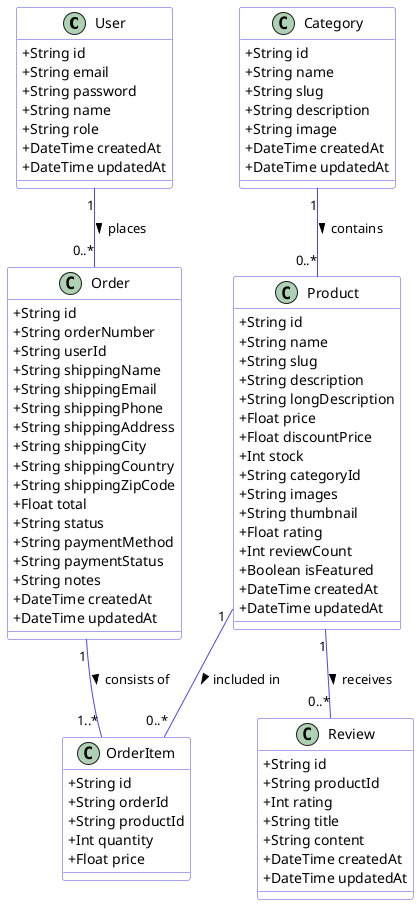
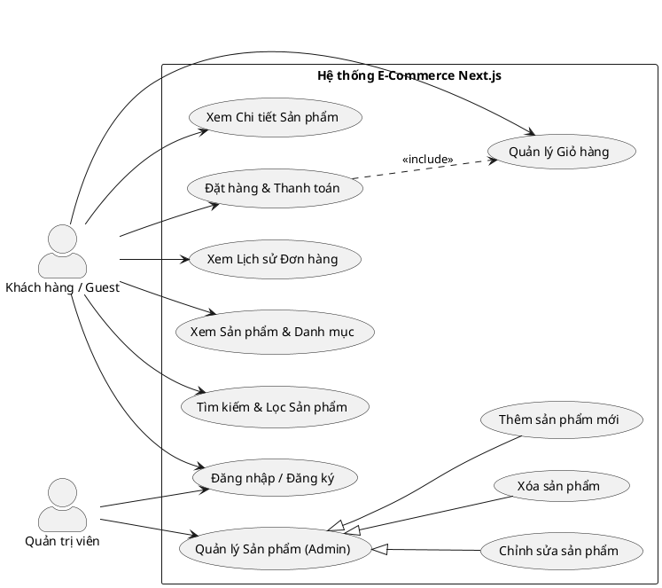
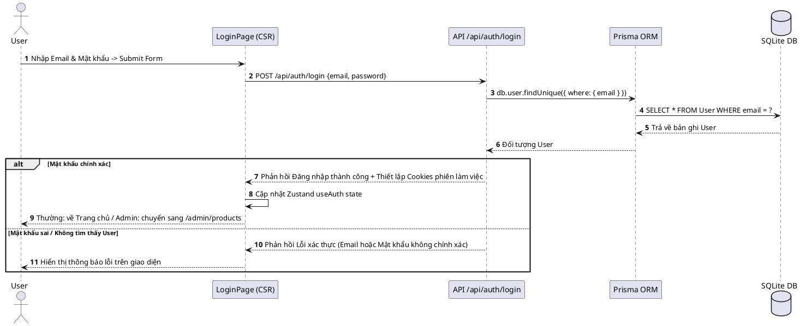
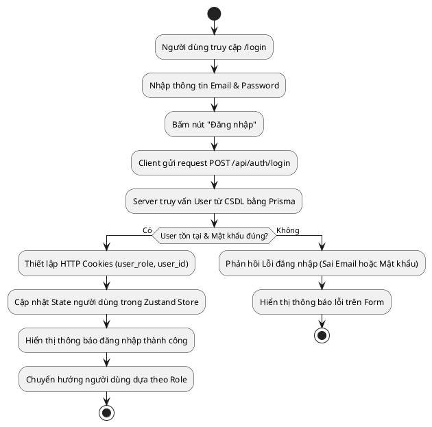
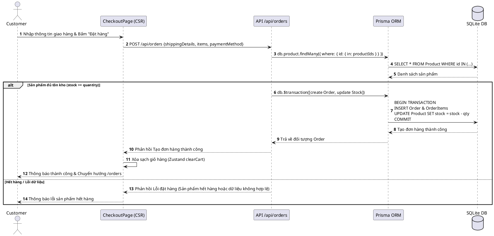
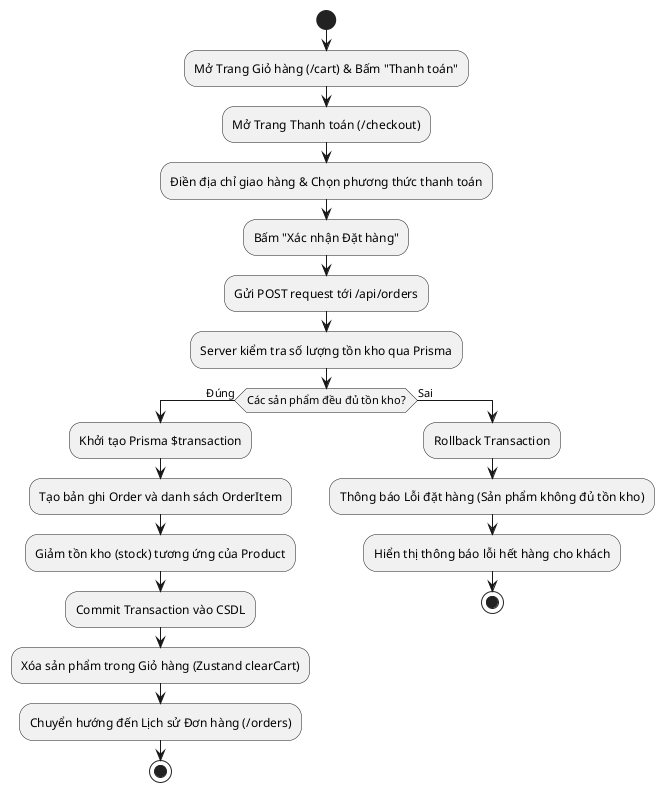
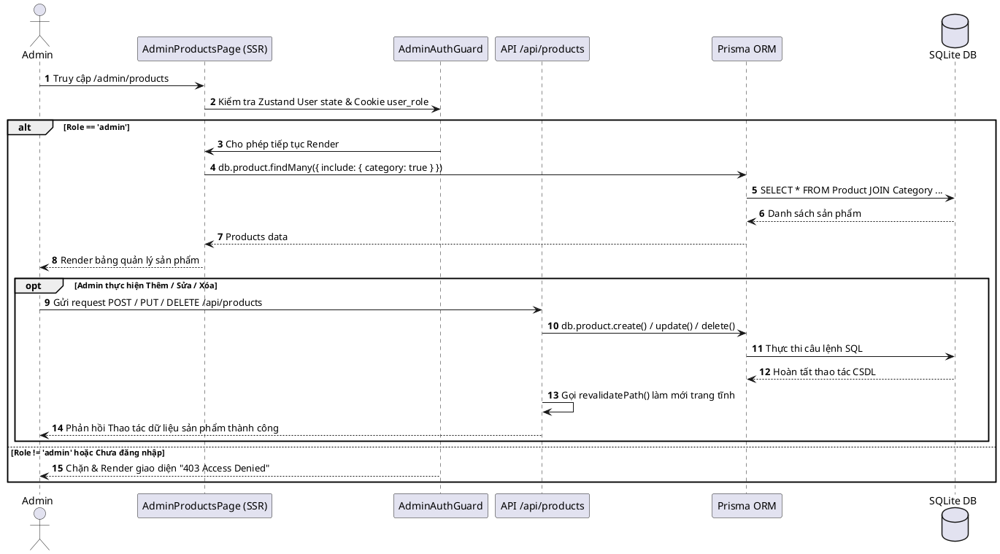
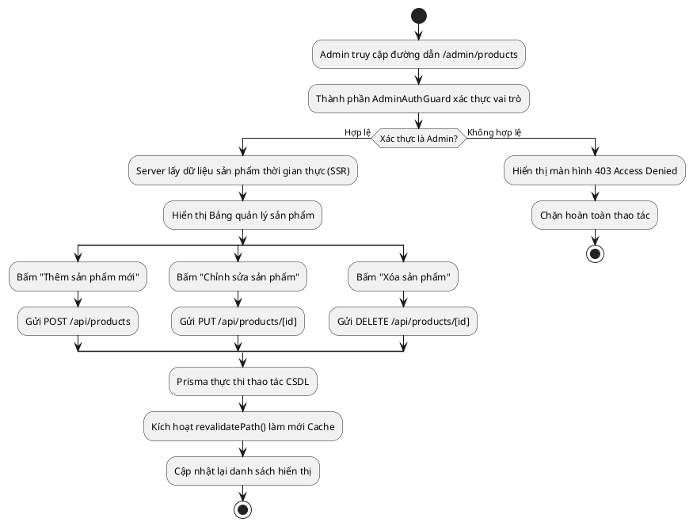
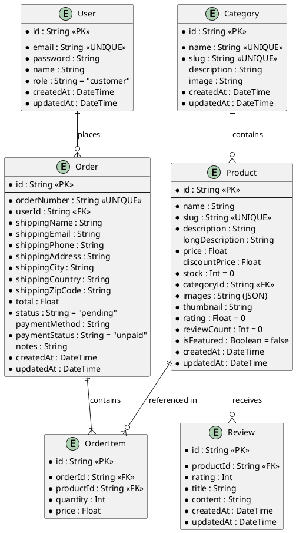

## MỤC LỤC
- [LỜI MỞ ĐẦU](#lời-mở-đầu)
- [DANH MỤC HÌNH ẢNH](#danh-mục-hình-ảnh)
- [DANH MỤC TỪ VIẾT TẮT](#danh-mục-từ-viết-tắt)
- [CHƯƠNG 1. GIỚI THIỆU](#chương-1-giới-thiệu)
  - [1.1. Đặt vấn đề](#11-đặt-vấn-đề)
  - [1.2. Lý do chọn đề tài](#12-lý-do-chọn-đề-tài)
  - [1.3. Mục tiêu đề tài](#13-mục-tiêu-đề-tài)
  - [1.4. Phương pháp nghiên cứu](#14-phương-pháp-nghiên-cứu)
  - [1.5. Ý nghĩa đề tài](#15-ý-nghĩa-đề-tài)
- [CHƯƠNG 2. KIẾN THỨC NỀN TẢNG](#chương-2-kiến-thức-nền-tảng)
  - [2.1. Giới thiệu về Next.js và TypeScript](#21-giới-thiệu-về-nextjs-và-typescript)
  - [2.2. App Router trong Next.js](#22-app-router-trong-nextjs)
  - [2.3. Các chiến lược Rendering](#23-các-chiến-lược-rendering)
  - [2.4. Giới thiệu ngắn gọn về Prisma ORM](#24-giới-thiệu-ngắn-gọn-về-prisma-orm)
- [CHƯƠNG 3. PHÂN TÍCH VÀ THIẾT KẾ HỆ THỐNG](#chương-3-phân-tích-về-thiết-kế-hệ-thống)
  - [3.1. Phân tích yêu cầu hệ thống](#31-phân-tích-yêu-cầu-hệ-thống)
  - [3.2. Thiết kế kiến trúc UML và mô hình khái niệm](#32-thiết-kế-kiến-trúc-uml-và-mô-hình-khái-niệm)
    - [3.2.1. Class Diagram](#321-class-diagram)
    - [3.2.2. Use Case Diagram và Bảng tả Use Case](#322-use-case-diagram-và-bảng-tả-use-case)
    - [3.2.3. Activity & Sequence Diagram](#323-activity--sequence-diagram)
  - [3.3. Thiết kế Cơ sở dữ liệu](#33-thiết-kế-cơ-sở-dữ-liệu)
    - [3.3.1. Sơ đồ thực thể mối quan hệ (ERD Diagram)](#331-sơ-đồ-thực-thể-mối-quan-hệ-erd-diagram)
    - [3.3.2. Mã nguồn schema.prisma chi tiết và diễn giải](#332-mã-nguồn-schemaprisma-chi-tiết-và-diễn-giải)
  - [3.4. Phân bổ chiến lược Rendering & Cấu trúc thư mục](#34-phân-bổ-chiến-lược-rendering--cấu-trúc-thư-mục)
    - [3.4.1. Cấu trúc thư mục thực tế của dự án](#341-cấu-trúc-thư-mục-thực-tế-của-dự-án)
    - [3.4.2. Bảng phân bổ Route & Chiến lược Rendering](#342-bảng-phân-bổ-route--chiến-lược-rendering)
- [CHƯƠNG 4. CÀI ĐẶT VÀ TRIỂN KHAI ỨNG DỤNG](#chương-4-cài-đặt-và-triển-khai-ứng-dụng)
  - [4.1. Tổng quan giao diện và các Chức năng hệ thống](#41-tổng-quan-giao-diện-và-các-chức-năng-hệ-thống)
  - [4.2. Kịch bản Chạy Demo chi tiết](#42-kịch-bản-chạy-demo-chi-tiết)
    - [4.2.1. Luồng Khách hàng (User / Guest)](#421-luồng-khách-hàng-user--guest)
    - [4.2.2. Luồng Quản trị viên (Admin)](#422-luồng-quản-trị-viên-admin)
- [CHƯƠNG 5. ĐÁNH GIÁ VÀ KẾT LUẬN](#chương-5-đánh-giá-và-kết-luận)
  - [5.1. Đánh giá kết quả đạt được](#51-đánh-giá-kết-quả-đạt-được)
  - [5.2. Hạn chế thực tế và Hướng phát triển tiếp theo](#52-hạn-chế-thực-tế-và-hướng-phát-triển-tiếp-theo)
  - [5.3. Kết luận chung](#53-kết-luận-chung)
- [TÀI LIỆU THAM KHẢO](#tài-liệu-tham-khảo)

---

## DANH MỤC HÌNH ẢNH
| STT | Tên hình ảnh | Trang |
| :---: | :--- | :---: |
| 1 | Các tính năng và lợi ích cốt lõi của Next.js trong phát triển ứng dụng Web | |
| 2 | Cơ chế ánh xạ hệ thống định tuyến dựa trên cấu trúc thư mục (File-based Routing) | |
| 3 | Cơ chế kế thừa giao diện lồng nhau và định tuyến động (Nested Layouts) | |
| 4 | Quy trình hoạt động của Client-Side Rendering (CSR) | |
| 5 | Quy trình hoạt động của Server-Side Rendering (SSR) | |
| 6 | Quy trình hoạt động của Static Site Generation (SSG) | |
| 7 | Quy trình hoạt động của Incremental Static Regeneration (ISR) | |
| 8 | Luồng kiến trúc các thành phần trong Prisma ORM | |
| 9 | Giao diện Trang chủ hệ thống (`demo-home.png`) | |
| 10 | Giao diện Tìm kiếm và Lọc sản phẩm (`demo-products-search.png`) | |
| 11 | Giao diện Trang chi tiết sản phẩm (`demo-product-detail.png`) | |
| 12 | Giao diện Giỏ hàng tương tác (`demo-cart.png`) | |
| 13 | Giao diện Thanh toán & Đặt hàng (`demo-checkout.png`) | |
| 14 | Giao diện Đăng nhập và Xác thực (`demo-auth.png`) | |
| 15 | Giao diện Dashboard Quản trị Sản phẩm Admin (`demo-admin-products.png`) | |
| 16 | Giao diện Thêm / Sửa Sản phẩm Admin (`demo-admin-form.png`) | |

---

## DANH MỤC TỪ VIẾT TẮT
| STT | Ký tự viết tắt | Tiếng Anh | Tiếng Việt |
| :---: | :--- | :--- | :--- |
| 1 | **SEO** | Search Engine Optimization | Tối ưu hoá công cụ tìm kiếm |
| 2 | **UI** | User Interface | Giao diện người dùng |
| 3 | **UX** | User Experience | Trải nghiệm người dùng |
| 4 | **SSR** | Server-Side Rendering | Kết xuất phía máy chủ |
| 5 | **SSG** | Static Site Generation | Khởi tạo trang tĩnh |
| 6 | **ISR** | Incremental Static Regeneration | Tái tạo trang tĩnh tăng tiến |
| 7 | **CSR** | Client-Side Rendering | Kết xuất phía trình duyệt |
| 8 | **RSC** | React Server Components | Thành phần React phía máy chủ |
| 9 | **ORM** | Object-Relational Mapping | Ánh xạ quan hệ - đối tượng |
| 10 | **FCP** | First Contentful Paint | Thời gian hiển thị nội dung đầu tiên |
| 11 | **TTI** | Time to Interactive | Thời gian sẵn sàng tương tác |
| 12 | **CRUD** | Create, Read, Update, Delete | Thêm, Xem, Sửa, Xóa dữ liệu |

---

## LỜI MỞ ĐẦU
Trong bối cảnh hiện nay, kinh tế số có những bước phát triển vượt bậc, thương mại điện tử (e-commerce) đã trở thành một phần không thể thiếu trong hoạt động kinh doanh của các doanh nghiệp cũng như thói quen tiêu dùng của xã hội. Sự cạnh tranh khốc liệt trên thị trường trực truyến đòi hỏi các website bán hàng không chỉ dừng lại ở việc cung cấp đầy đủ tính năng, mà còn phải đáp ứng những yêu cầu tiêu chuẩn cực kỳ khắt khe về tốc độ tải trang (Performance), khả năng tối ưu hoá công cụ tìm kiếm (SEO) để tiếp cận khách hàng tự nhiên, và sự kết hợp hoàn hảo giữa giao diện trực quan (UI) cùng trải nghiệm người dùng mượt mà (UX).

Các giải pháp xây dựng website truyền thống hoặc các Single Page Application (SPA) thuần tuý trước đây dần bộc lộ những hạn chế lớn. Điển hình là việc Web phụ thuộc hoàn toàn vào Client-Side Rendering (CSR) khiến thời gian tải trang đầu tiên (FCP) bị kéo dài và gây cản trở nghiêm trọng cho các robot tìm kiếm (SEO Crawlers) khi thu thập dữ liệu.

Để giải quyết bài toán này tối ưu, các công nghệ Web hiện đại đã chuyển dịch mạnh mẽ sang mô hình Hybrid Rendering. Nhận thấy tiềm năng vượt trội của hệ sinh thái React, em đã lựa chọn nghiên cứu và thực hiện đề tài: **“Xây dựng Website bán hàng với Next.js App Router + TypeScript”**.

Đề tài này không chỉ dừng lại ở việc tạo ra một ứng dụng mua bán trực tuyến đầy đủ chức năng, mà tập trung nghiên cứu sâu vào việc tối ưu hoá kiến trúc hệ thống:
* **Ứng dụng Next.js App Router:** Khai thác sức mạnh của mô hình phân chia cấu trúc trang linh hoạt, kết hợp nhuần nhuyễn giữa React Server Components (RSC) và Client Components để giảm thiểu tối đa dung lượng JavaScript tải xuống trình duyệt của mỗi người dùng.
* **Tối ưu hoá các chiến lược Rendering:** Phân tích kỹ lưỡng từng phân hệ chức năng để áp dụng chiến lược hiển thị phù hợp nhất. Từ việc sử dụng Static Site Generation (SSG) kết hợp Incremental Static Regeneration (ISR) cho trang chủ và trang sản phẩm nhằm đạt tốc độ tải trang tức thì và tối ưu SEO, cho đến việc áp dụng Server-Side Rendering (SSR) cho trang thanh toán bảo mật và Client-Side Rendering (CSR) để xử lý các tương tác thời gian thực tại trang giỏ hàng.
* **Đảm bảo tính toàn vẹn hệ thống với TypeScript và Prisma:** Sử dụng TypeScript xuyên suốt từ Front-end đến Backend giúp phát hiện lỗi sớm trong quá trình phát triển, kết hợp cùng Prisma ORM để giao tiếp với cơ sở dữ liệu một cách an toàn và tường minh.

---

## CHƯƠNG 1. GIỚI THIỆU

### 1.1. Đặt vấn đề
Trong kỷ nguyên số hoá, thương mại điện tử không còn là một kênh bán hàng phụ trợ mà đã trở thành trọng điểm kinh doanh. Tuy nhiên, sự phát triển này cũng đi kèm với kỳ vọng ngày càng lớn từ phía người dùng. Khách hàng không còn đủ kiên nhẫn để chờ đợi một trang web tải chậm. Theo các nghiên cứu về UX, chỉ cần trang web tải chậm quá 3 giây, tỉ lệ khách hàng rời bỏ hệ thống sẽ tăng lên hơn 50%.

Bên cạnh đó, đối với một website bán hàng, SEO là yếu tố sống còn để doanh nghiệp tiếp cận khách hàng tự nhiên. Các giải pháp Single Page Application (SPA) truyền thống (như ReactJS thuần) sử dụng cơ chế Client-Side Rendering (CSR) thường gặp bất lợi lớn về SEO do robot tìm kiếm khó lập chỉ mục các trang web trống rỗng trước khi JavaScript được thực thi ở trình duyệt. Bài toán đặt ra là làm thế nào để giữ được trải nghiệm mượt mà của SPA, vừa tối ưu hoá tốc độ tải trang lần đầu và đảm bảo thân thiện với các bộ máy tìm kiếm.

### 1.2. Lý do chọn đề tài
Next.js với kiến trúc App Router mới nhất nổi lên như một giải pháp hàng đầu cho phép linh hoạt lựa chọn giữa Server Components và Client Components, kết hợp các chiến lược Rendering (SSG, SSR, ISR, CSR) trên từng trang riêng biệt.

Bên cạnh đó, xây dựng hệ thống e-commerce đòi hỏi sự chặt chẽ về mặt dữ liệu để tránh lỗi logic trong mua bán. TypeScript với cơ chế static typing giúp kiểm soát chặt chẽ mã nguồn, hạn chế tối đa lỗi runtime và tăng khả năng bảo trì. Chính vì vậy, em chọn đề tài **“Xây dựng Website bán hàng với Next.js App Router + TypeScript”** nhằm nghiên cứu sâu vào cách tối ưu hiệu năng và SEO cho hệ thống thương mại điện tử.

### 1.3. Mục tiêu đề tài
* **Nghiên cứu lý thuyết:**
  * Tìm hiểu sâu về cơ chế hoạt động của Next.js App Router, sự khác biệt và cách phối hợp giữa RSC và Client Components.
  * Phân tích và nắm vững các chiến lược hiển thị: CSR, SSR, SSG và ISR.
  * Nghiên cứu cách thiết kế hệ thống Type-safe từ Front-end đến Database với TypeScript và Prisma ORM.
* **Xây dựng ứng dụng thực tiễn:**
  * Xây dựng hoàn chỉnh ứng dụng Website bán hàng đầy đủ giao diện và tính năng.
  * Hiện thực hoá các trang chức năng tối ưu (SSG/ISR cho Trang chủ/Sản phẩm, CSR cho Giỏ hàng, SSR cho Thanh toán và Admin).
  * Đạt điểm tối ưu trên các công cụ đo lường hiệu năng (Google Lighthouse) về Performance, SEO và Accessibility.

### 1.4. Phương pháp nghiên cứu
* Đọc và phân tích các tài liệu chính thức của Next.js, TypeScript và Prisma; nghiên cứu kiến trúc Web Rendering từ các nguồn uy tín.
* Khảo sát thực trạng các trang web e-commerce, phân tích ưu/nhược điểm từng giải pháp để đưa ra thiết kế kiến trúc hệ thống, luồng dữ liệu và thiết kế CSDL thông qua Prisma.

### 1.5. Ý nghĩa đề tài
* Đóng góp nghiên cứu thực nghiệm về hiệu quả của việc kết hợp các chiến lược Rendering đối với hiệu năng và SEO của website thương mại điện tử.
* Tạo ra một sản phẩm trang web bán hàng hoàn chỉnh, tốc độ phản hồi cao, có khả năng ứng dụng thực tế cho doanh nghiệp vừa và nhỏ, đồng thời làm tài liệu tham khảo cho các lập trình viên.

---

## CHƯƠNG 2. KIẾN THỨC NỀN TẢNG

### 2.1. Giới thiệu về Next.js và TypeScript
#### 2.1.1. Next.js là gì? Lịch sử phát triển
Next.js là một framework mã nguồn mở dành cho React nhằm xây dựng các ứng dụng web full-stack. Ra đời năm 2016, Next.js đã phát triển qua nhiều cột mốc quan trọng:
* **Năm 2016:** Ra mắt với mục tiêu render phía máy chủ cho React.
* **Năm 2022 (v13.0):** Giới thiệu kiến trúc App Router tích hợp React Server Components (RSC).
* **Phiên bản hiện tại (v15.0+):** Ổn định các tính năng App Router và RSC thành chuẩn phát triển ứng dụng web hiện đại.

#### 2.1.2. Tại sao chọn Next.js + TypeScript?
1. **Tối ưu hiệu năng & SEO:** Nhờ các cơ chế Rendering linh hoạt.
2. **Kiểm soát lỗi dữ liệu:** TypeScript phát hiện lỗi ngay lúc biên dịch (compile-time) thay vì lúc thực thi (runtime).
3. **An toàn kiểu dữ liệu xuyên suốt:** Đảm bảo dữ liệu nhất quán từ Database $\rightarrow$ API $\rightarrow$ Frontend.

---

### 2.2. App Router trong Next.js

#### 2.2.1. File-based Routing & Nested Layouts
* **File-based Routing:** Đã thay đổi cách định tuyến bằng cấu trúc thư mục trong `/app`. Ví dụ: thư mục `/app/products/page.tsx` sẽ tương ứng với đường dẫn `/products`.
* **Nested Layouts (`layout.tsx`):** Cho phép tái sử dụng các thành phần giao diện chung (Header, Footer) mà không phải re-render lại khi chuyển trang.

#### 2.2.2. Server Components vs Client Components
* **React Server Components (RSC):** Mặc định trong `/app`, chạy hoàn toàn trên Server, giúp giảm kích thước bundle JavaScript gửi xuống Client.
* **Client Components:** Khai báo chỉ thị `"use client"` ở đầu file, dùng cho các thành phần cần tính tương tác cao (sử dụng State, Effect, Event Listeners).

##### Bảng so sánh Server Components và Client Components:
| Tiêu chí phân loại | Server Components (Mặc định) | Client Components (Thêm `"use client"`) |
| :--- | :--- | :--- |
| **Môi trường thực thi** | Máy chủ (Server) | Máy khách / Trình duyệt (Browser) |
| **Truy vấn Dữ liệu** | Trực tiếp từ CSDL (Prisma) hoặc API nội bộ | Qua API Routes hoặc Hooks client |
| **Tính bảo mật** | An toàn, giữ API Keys/Tokens trên Server | Mã nguồn hiển thị ở Client |
| **Dung lượng JS Bundle** | Không làm tăng dung lượng JS tải về | Tăng dung lượng phụ thuộc vào component |
| **React Hooks** | Không hỗ trợ `useState`, `useEffect` | Hỗ trợ đầy đủ các React Hooks & Browser APIs |
| **Ví dụ ứng dụng** | Trang danh sách sản phẩm, Trang chi tiết | Nút "Thêm vào giỏ hàng", Form nhập liệu |

---

### 2.3. Các chiến lược Rendering

#### 2.3.1. Client-Side Rendering (CSR)
* **Khái niệm & Cơ chế:** Server trả về file HTML rỗng kèm file JS. Trình duyệt thực thi JS để dựng giao diện và gọi API lấy dữ liệu.
* **Ưu điểm:** Chuyển trang mượt mà sau lần tải đầu, giảm tải cho Server.
* **Nhược điểm:** SEO kém, thời gian tải trang đầu (FCP) chậm.
* **Áp dụng:** Trang giỏ hàng (`/cart`), Trang thông tin cá nhân (`/profile`).

#### 2.3.2. Server-Side Rendering (SSR)
* **Khái niệm & Cơ chế:** Mỗi request đến, Server sẽ lấy dữ liệu mới nhất, dựng file HTML hoàn chỉnh rồi trả về cho Browser.
* **Ưu điểm:** Nội dung luôn mới nhất thời gian thực, SEO rất tốt.
* **Nhược điểm:** Tăng tải cho Server, thời gian phản hồi phụ thuộc vào xử lý của Server.
* **Áp dụng:** Trang kết quả tìm kiếm (`/search`), Trang quản trị (`/admin/products`).

#### 2.3.3. Static Site Generation (SSG)
* **Khái niệm & Cơ chế:** Trang HTML được sinh ra sẵn một lần duy nhất tại thời điểm Build Time (`npm run build`).
* **Ưu điểm:** Tốc độ phản hồi cực nhanh, SEO tối ưu tuyệt đối.
* **Nhược điểm:** Dữ liệu bị tĩnh, muốn cập nhật phải rebuild lại toàn bộ dự án.
* **Áp dụng:** Trang Giới thiệu (`/about`), Trang Chính sách (`/policy`).

#### 2.3.4. Incremental Static Regeneration (ISR)
* **Khái niệm & Cơ chế:** Mở rộng từ SSG, cho phép tái tạo (revalidate) ngầm file HTML tĩnh theo chu kỳ thời gian (ví dụ: `revalidate: 60`s) hoặc theo sự kiện (revalidatePath) mà không cần rebuild lại toàn bộ hệ thống.
* **Ưu điểm:** Tốc độ nhanh như SSG nhưng dữ liệu luôn được làm mới định kỳ.
* **Nhược điểm:** Người dùng đầu tiên sau khoảng thời gian revalidate có thể thấy dữ liệu cũ tạm thời.
* **Áp dụng:** Trang chi tiết sản phẩm (`/products/[slug]`), Trang chủ (`/`).

##### Bảng tổng hợp so sánh các chiến lược Rendering:
| Tiêu chí | CSR | SSR | SSG | ISR |
| :--- | :--- | :--- | :--- | :--- |
| **Thời điểm Render** | Tại Trình duyệt | Khi có Request | Lúc Build Time | Build Time + Cập nhật ngầm |
| **Tốc độ tải đầu** | Chậm | Trung bình | Rất nhanh | Rất nhanh (từ Cache) |
| **Khả năng SEO** | Hạn chế | Rất tốt | Tối ưu tuyệt đối | Tối ưu tuyệt đối |
| **Tải lên Server/CSDL** | Thấp | Cao | Rất thấp | Rất thấp |
| **Tính thời gian thực** | Cao (qua API) | Tuyệt đối | Thấp | Cao (theo chu kỳ / trigger) |
| **Trường hợp ứng dụng** | Giỏ hàng, Profile | Tìm kiếm, Admin Dashboard | Giới thiệu, Điều khoản | Chi tiết sản phẩm, Trang chủ |

---

### 2.4. Giới thiệu ngắn gọn về Prisma ORM
* **Khái niệm & Kiến trúc:** Prisma là ORM thế hệ mới cho Node.js/TypeScript gồm 3 thành phần chính:
  1. `Prisma Schema`: Khai báo mô hình dữ liệu tập trung.
  2. `Prisma Client`: Bộ truy vấn Type-safe tự động sinh.
  3. `Prisma Migrate`: Quản lý migration và đồng bộ CSDL.
* **Lý do lựa chọn:**
  * Đảm bảo an toàn kiểu dữ liệu (Type-safe) 100%.
  * Tích hợp tự nhiên với React Server Components và Server Actions.
  * Tối ưu hóa các truy vấn quan hệ phức tạp (1-N, N-N).

---

## CHƯƠNG 3. PHÂN TÍCH VÀ THIẾT KẾ HỆ THỐNG

### 3.1. Phân tích yêu cầu hệ thống

#### 3.1.1. Khảo sát các giải pháp E-commerce tại Việt Nam
* **Sàn TMĐT (Shopee, Lazada):** Ưu điểm có sẵn khách hàng, nhược điểm chiết khấu cao và bị phụ thuộc.
* **SaaS nội địa (Haravan, Sapo):** Triển khai nhanh, nhược điểm tốn chi phí cố định và khó can thiệp sâu mã nguồn.
* **Custom Platform (Next.js + Prisma):** Tối ưu trải nghiệm, làm chủ 100% dữ liệu và mã nguồn, đạt điểm SEO và hiệu năng tối đa.

#### 3.1.2. Phân tích yêu cầu chức năng
* **Phân quyền người dùng:**
  * **Customer / Guest:** Khách tham quan, mua sắm.
  * **Admin:** Quản trị viên hệ thống.
* **Phân hệ Khách hàng:**
  * Đăng ký, Đăng nhập, Quản lý tài khoản.
  * Xem Trang chủ, Danh sách sản phẩm, Tìm kiếm & Lọc.
  * Chi tiết sản phẩm, Quản lý giỏ hàng, Thanh toán & Đặt hàng.
* **Phân hệ Quản trị (Admin Dashboard):**
  * Quản lý sản phẩm (Thêm, Sửa, Xóa, Xem danh sách).
  * Quản lý danh mục & Quản lý đơn hàng.

---

### 3.2. Thiết kế kiến trúc UML và mô hình khái niệm

#### 3.2.1. Class Diagram
Sơ đồ lớp dưới đây thể hiện các Entity chính trong cơ sở dữ liệu thực tế của ứng dụng (`User`, `Category`, `Product`, `Order`, `OrderItem`, `Review`) cùng với các thuộc tính và mối quan hệ quan trọng giữa chúng.



#### 3.2.2. Use Case Diagram và Bảng tả Use Case

##### Sơ đồ Use Case tổng quan (Use Case Diagram):
Sơ đồ mô tả sự tương tác của 2 Actor chính: Khách hàng / Guest (`Customer`) và Quản trị viên (`Admin`).



##### Bảng tả Use Case 1: Use case "Đặt hàng & Thanh toán"
| Tên Use case | Use case "Đặt hàng & Thanh toán" |
| :--- | :--- |
| **Mục đích** | Cho phép Khách hàng tiến hành gửi đơn đặt hàng và thanh toán cho các sản phẩm có trong giỏ hàng. |
| **Tác nhân** | Khách hàng (User) / Khách vãng lai (Guest) |
| **Điều kiện tiên quyết** | Khách hàng đang ở màn hình Giỏ hàng (`/cart`) và giỏ hàng có ít nhất 01 sản phẩm. |
| **Luồng sự kiện** | 1. Khách hàng chọn chức năng "Thanh toán".<br>2. Hệ thống hiển thị biểu mẫu thanh toán tại đường dẫn `/checkout`.<br>3. Khách hàng nhập thông tin giao hàng (Họ tên, Email, SĐT, Địa chỉ, Thành phố) và chọn Phương thức thanh toán.<br>4. Khách hàng nhấn "Xác nhận Đặt hàng".<br>5. Client gửi yêu cầu `POST /api/orders` tới Server.<br>6. Server kiểm tra tồn kho, thực thi giao dịch Prisma `$transaction` để tạo Đơn hàng, Chi tiết đơn hàng và tự động giảm số lượng tồn kho sản phẩm.<br>7. Hệ thống xóa sạch giỏ hàng trong Zustand store và thông báo "Đặt hàng thành công".<br>8. Hệ thống chuyển hướng người dùng tới trang Lịch sử đơn hàng (`/orders`).<br>9. Kết thúc Use case. |
| **Kết quả** | Đơn hàng được tạo thành công trong CSDL, số lượng tồn kho sản phẩm được cập nhật chính xác và người dùng theo dõi được đơn hàng của mình. |

##### Bảng tả Use Case 2: Use case "Quản lý sản phẩm"
| Tên Use case | Use case "Quản lý sản phẩm" |
| :--- | :--- |
| **Mục đích** | Cho phép Quản trị viên điều chỉnh, cập nhật hoặc xóa thông tin sản phẩm trong hệ thống. |
| **Tác nhân** | Quản trị viên (Admin) |
| **Điều kiện tiên quyết** | Quản trị viên đã đăng nhập thành công với vai trò Admin và đang ở màn hình Quản lý sản phẩm (`/admin/products`). |
| **Luồng sự kiện** | 1. Quản trị viên chọn chức năng Thêm mới, Chỉnh sửa hoặc Xóa sản phẩm.<br>2. **Trường hợp Thêm mới:** Hệ thống hiển thị biểu mẫu tại `/admin/products/new`. Quản trị viên nhập thông tin sản phẩm và nhấn "Lưu sản phẩm". Client gửi `POST /api/products`.<br>3. **Trường hợp Chỉnh sửa:** Hệ thống hiển thị biểu mẫu chi tiết sản phẩm hiện tại tại `/admin/products/[id]/edit`. Quản trị viên nhập các thông tin cần thay đổi và nhấn "Cập nhật". Client gửi `PUT /api/products/[id]`.<br>4. **Trường hợp Xóa:** Quản trị viên nhấn nút "Xóa" tại dòng sản phẩm tương ứng và nhấn "Xác nhận" trên hộp thoại cảnh báo. Client gửi `DELETE /api/products/[id]`.<br>5. Hệ thống thực thi lưu các thay đổi hoặc xóa bản ghi trong cơ sở dữ liệu qua Prisma ORM.<br>6. Hệ thống tự động kích hoạt `revalidatePath()` làm mới cache dữ liệu trên toàn hệ thống.<br>7. Hệ thống thông báo "Thao tác thành công" và cập nhật danh sách hiển thị.<br>8. Kết thúc Use case. |
| **Kết quả** | Thông tin sản phẩm được cập nhật chính xác trong cơ sở dữ liệu và dữ liệu hiển thị trên các trang bán hàng công khai được đồng bộ tức thì. |

---

#### 3.2.3. Activity & Sequence Diagram

##### a. Phân hệ Xác thực (Auth Flow)
* **Sequence Diagram:**



* **Activity Diagram:**



##### b. Phân hệ Giỏ hàng & Đặt hàng (Checkout Flow)
* **Sequence Diagram:**



* **Activity Diagram:**



##### c. Phân hệ Quản trị sản phẩm (Admin Product Management)
* **Sequence Diagram:**



* **Activity Diagram:**



---

### 3.3. Thiết kế Cơ sở dữ liệu

#### 3.3.1. Sơ đồ thực thể mối quan hệ (ERD Diagram)



---

#### 3.3.2. Mã nguồn schema.prisma chi tiết và diễn giải

```prisma
datasource db {
  provider = "sqlite"
  url      = "file:./dev.db"
}

generator client {
  provider = "prisma-client-js"
}

model User {
  id        String   @id @default(cuid())
  email     String   @unique
  password  String
  name      String
  role      String   @default("customer") // "customer" | "admin"
  createdAt DateTime @default(now())
  updatedAt DateTime @updatedAt

  orders Order[]
}

model Category {
  id          String    @id @default(cuid())
  name        String    @unique
  slug        String    @unique
  description String?
  image       String?
  createdAt   DateTime  @default(now())
  updatedAt   DateTime  @updatedAt

  products Product[]
}

model Product {
  id              String   @id @default(cuid())
  name            String
  slug            String   @unique
  description     String
  longDescription String?
  price           Float
  discountPrice   Float?
  stock           Int      @default(0)

  categoryId String
  category   Category @relation(fields: [categoryId], references: [id], onDelete: Cascade)

  // Media (Lưu mảng JSON chuỗi để tối ưu tương thích với SQLite)
  images    String
  thumbnail String

  // Metadata
  rating      Float   @default(0)
  reviewCount Int     @default(0)
  isFeatured  Boolean @default(false)

  // Timestamps
  createdAt DateTime @default(now())
  updatedAt DateTime @updatedAt

  // Relations
  orderItems OrderItem[]
  reviews    Review[]

  @@index([categoryId])
  @@index([slug])
}

model Order {
  id          String   @id @default(cuid())
  orderNumber String   @unique

  userId String
  user   User   @relation(fields: [userId], references: [id], onDelete: Cascade)

  items OrderItem[]

  // Shipping
  shippingName    String
  shippingEmail   String
  shippingPhone   String
  shippingAddress String
  shippingCity    String
  shippingCountry String
  shippingZipCode String

  // Payment
  total         Float
  status        String  @default("pending") // "pending" | "processing" | "shipped" | "delivered" | "cancelled"
  paymentMethod String? // "credit_card" | "bank_transfer" | "cash"
  paymentStatus String  @default("unpaid") // "unpaid" | "paid" | "failed"

  notes String?

  createdAt DateTime @default(now())
  updatedAt DateTime @updatedAt

  @@index([userId])
  @@index([status])
  @@index([createdAt])
}

model OrderItem {
  id String @id @default(cuid())

  orderId String
  order   Order  @relation(fields: [orderId], references: [id], onDelete: Cascade)

  productId String
  product   Product @relation(fields: [productId], references: [id])

  quantity Int
  price    Float

  @@unique([orderId, productId])
  @@index([orderId])
}

model Review {
  id String @id @default(cuid())

  productId String
  product   Product @relation(fields: [productId], references: [id], onDelete: Cascade)

  rating  Int
  title   String
  content String

  createdAt DateTime @default(now())
  updatedAt DateTime @updatedAt

  @@index([productId])
}
```

##### Diễn giải kỹ thuật thiết kế Schema:
1. **Khóa chính (Primary Keys):** Tất cả các bảng sử dụng kiểu `cuid()` làm ID khóa chính. Điều này giúp ngăn chặn các cuộc tấn công quét ID nối tiếp (ID enumeration) so với ID tự tăng Auto-Increment truyền thống.
2. **Quản lý Media cho SQLite:** Do SQLite không hỗ trợ sẵn kiểu dữ liệu Native Array, trường `images` của model `Product` được thiết kế dưới dạng chuỗi Text lưu mã mã hóa JSON (`JSON.stringify(string[])`), giúp đảm bảo tương thích 100% với SQLite mà không cần cài đặt thêm server DB phức tạp.
3. **Mối quan hệ & Ràng buộc toàn vẹn:**
   - Quan hệ **1 - N** giữa `Category` và `Product` với `onDelete: Cascade` giúp tự động xóa sạch các sản phẩm liên quan khi danh mục bị xóa.
   - Quan hệ **1 - N** giữa `User` và `Order` xác định người dùng nào sở hữu đơn hàng.
   - Bảng trung gian `OrderItem` kết nối quan hệ **N - N** giữa `Order` và `Product`, chứa thông tin snapshot số lượng (`quantity`) và đơn giá tại thời điểm mua (`price`), được đánh ràng buộc `@@unique([orderId, productId])` để tránh trùng lặp mặt hàng trong cùng một đơn.
4. **Tối ưu truy vấn bằng Indexes:** Các chỉ mục (Indexes) được tạo trên các trường tần suất tìm kiếm cao như `Product(slug)`, `Product(categoryId)`, `Order(userId)`, `Order(status)` giúp truy vấn CSDL đạt tốc độ tối đa.

---

### 3.4. Phân bổ chiến lược Rendering & Cấu trúc thư mục

#### 3.4.1. Cấu trúc thư mục thực tế của dự án
Ứng dụng được tổ chức theo chuẩn kiến trúc Next.js App Router:

```text
commerce/
├── app/                        # Thư mục App Router chính
│   ├── [page]/                 # Các trang nội dung tĩnh động
│   ├── admin/                  # Phân hệ Quản trị Admin
│   │   ├── layout.tsx          # Layout bọc bảo mật với AdminAuthGuard
│   │   └── products/           # Quản lý sản phẩm (List, Create, Edit)
│   ├── api/                    # API Route Handlers (REST APIs)
│   │   ├── auth/               # APIs Đăng nhập, Đăng ký, Đăng xuất
│   │   ├── categories/         # API lấy danh mục
│   │   ├── orders/             # API xử lý đặt hàng & lấy lịch sử đơn
│   │   ├── products/           # RESTful CRUD APIs Sản phẩm
│   │   └── search/             # API tìm kiếm sản phẩm
│   ├── cart/                   # Trang Giỏ hàng (CSR)
│   ├── checkout/               # Trang Thanh toán (CSR)
│   ├── login/ & register/      # Trang Xác thực người dùng (CSR)
│   ├── orders/ & profile/      # Trang Lịch sử đơn hàng & Cá nhân (CSR)
│   ├── product/ & products/    # Trang Danh sách & Chi tiết sản phẩm (SSG / ISR)
│   ├── search/                 # Trang Tìm kiếm & Lọc sản phẩm (SSR)
│   ├── globals.css             # Stylesheet toàn cục (TailwindCSS)
│   ├── layout.tsx              # Root Layout (Header, Footer, Toast)
│   └── page.tsx                # Trang chủ ứng dụng (SSG + ISR)
├── components/                 # Tái sử dụng React Components
│   ├── admin/                  # Admin Components (AdminAuthGuard, DeleteButton)
│   ├── cart/                   # Cart Components (AddToCartButton, CartDrawer)
│   ├── common/                 # RenderingBadge, HeroAuthSection, Navbar
│   ├── products/               # ProductGrid, ProductCard, ImageGallery
│   └── ui/                     # UI Primitives
├── lib/                        # Thư viện & Cấu hình Core
│   ├── auth-store.ts           # State Management Đăng nhập (Zustand)
│   ├── store.ts                # State Management Giỏ hàng (Zustand + Persist)
│   ├── db.ts                   # Khởi tạo Singleton PrismaClient instance
│   ├── validation.ts           # Zod Schema validation dữ liệu
│   └── utils.ts                # Các hàm tiện ích bổ trợ
├── prisma/                     # Cấu hình Cơ sở dữ liệu
│   ├── schema.prisma           # Cấu trúc CSDL thực tế
│   └── seed.ts                 # Script khởi tạo dữ liệu mẫu
├── public/                     # Tài nguyên tĩnh (Hình ảnh, Icons)
├── next.config.ts              # Cấu hình Framework Next.js
├── package.json                # Khai báo Dependencies & Scripts
└── tsconfig.json               # Cấu hình TypeScript
```

---

#### 3.4.2. Bảng phân bổ Route & Chiến lược Rendering

| Đường dẫn (Route) | Loại Component | Chiến lược Rendering | Lý do lựa chọn kỹ thuật |
| :--- | :--- | :--- | :--- |
| `/` | Server Component | **SSG + ISR** (`revalidate: 60`) | Trang chủ chứa banner và các sản phẩm nổi bật ít thay đổi. Khởi tạo tĩnh tại Build Time giúp tải tức thì, làm mới ngầm sau 60 giây. |
| `/products` | Server Component | **SSG + ISR** (`revalidate: 60`) | Danh sách sản phẩm công khai cần tối ưu SEO và tốc độ truy cập ban đầu cho khách hàng. |
| `/products/[slug]` | Server Component | **SSG + ISR** (`generateStaticParams`) | Pre-render tĩnh toàn bộ trang chi tiết sản phẩm. Khi Admin cập nhật thông tin sản phẩm, gọi `revalidatePath()` để xóa cache làm mới ngay. |
| `/search` | Server Component | **SSR** (`dynamic = 'force-dynamic'`) | Tìm kiếm và lọc sản phẩm phụ thuộc trực tiếp vào tham số đường dẫn (`searchParams`). Cần render thời gian thực trên Server theo mỗi truy vấn của khách. |
| `/cart` | Client Component | **CSR** (`"use client"`) | Giỏ hàng lưu trữ và tính toán trực tiếp trên trình duyệt người dùng bằng Zustand + LocalStorage. Cần phản hồi tức thì các thao tác tăng/giảm số lượng. |
| `/checkout` | Client Component | **CSR** (`"use client"`) | Form nhập thông tin thanh toán cá nhân hóa. Thu thập dữ liệu Client và gửi yêu cầu tạo đơn đặt hàng qua API. |
| `/login` & `/register` | Client Component | **CSR** (`"use client"`) | Xử lý Form đăng nhập/đăng ký người dùng, tương tác với Local State và gửi request xác thực. |
| `/profile` & `/orders` | Client Component | **CSR** (`"use client"`) | Trang thông tin và đơn hàng cá nhân chỉ hiển thị sau khi Client xác thực Cookie và tải dữ liệu riêng của User. |
| `/admin/products` | Server Component | **SSR** (`revalidate = 0`) | Trang Dashboard Quản trị yêu cầu dữ liệu chính xác 100% thời gian thực. Phải render Server để kiểm tra dữ liệu tồn kho mới nhất. |
| `/admin/products/new` | Client Component | **CSR / SSR Form** | Form tạo sản phẩm mới dành cho Admin, tương tác dữ liệu động và gửi API `POST /api/products`. |
| `/admin/products/[id]/edit` | Client Component | **CSR / SSR Form** | Form cập nhật sản phẩm cho Admin, lấy dữ liệu hiện tại và gửi API `PUT /api/products/[id]`. |
| `/api/auth/*` | REST API Handler | **Server Execution** | Xử lý logic đăng nhập, đăng ký và thiết lập Cookie xác thực bảo mật `user_role` và `user_id`. |
| `/api/products/*` | REST API Handler | **Server Execution** | Xử lý CRUD sản phẩm với Prisma ORM, kích hoạt `revalidatePath()` để tự động cập nhật cache của các trang ISR/SSG. |
| `/api/orders/*` | REST API Handler | **Server Execution** | Xử lý tạo đơn hàng trong Prisma `$transaction`, tự động trừ kho sản phẩm và lưu bản ghi đơn hàng. |

---

## CHƯƠNG 4. CÀI ĐẶT VÀ TRIỂN KHAI ỨNG DỤNG

### 4.1. Tổng quan giao diện và các Chức năng hệ thống

Hệ thống được thiết kế theo phong cách giao diện hiện đại (Modern Dark Mode UI) sử dụng TailwindCSS, mang lại trải nghiệm thị giác ấn tượng, mượt mà và trực quan.

#### Màn hình 1: Trang chủ hệ thống (Homepage)

*Chú thích: Màn hình Trang chủ hiển thị Hero Banner ấn tượng, Rendering Badge thông báo chiến lược SSG+ISR (60s), danh mục sản phẩm nổi bật và các thẻ sản phẩm chất lượng cao.*

---

#### Màn hình 2: Trang Tìm kiếm và Lọc sản phẩm

*Chú thích: Màn hình Tìm kiếm & Lọc (SSR) cho phép người dùng tìm kiếm theo từ khóa, lọc theo danh mục và sắp xếp theo giá cả hoặc đánh giá thời gian thực.*

---

#### Màn hình 3: Trang Chi tiết sản phẩm

*Chú thích: Trang Chi tiết sản phẩm (SSG+ISR) hiển thị bộ sưu tập ảnh (Image Gallery), thông tin mô tả chi tiết, số lượng tồn kho còn lại, đánh giá sao và nút "Thêm vào giỏ hàng".*

---

#### Màn hình 4: Trang Giỏ hàng tương tác

*Chú thích: Màn hình Giỏ hàng (CSR) sử dụng Zustand Store lưu trữ LocalStorage, cho phép người dùng thay đổi số lượng, xóa mặt hàng, xem tổng tiền tự động cập nhật và bấm tiến hành Thanh toán.*

---

#### Màn hình 5: Trang Thanh toán & Đặt hàng

*Chú thích: Màn hình Thanh toán (Checkout) chứa Form thu thập địa chỉ giao hàng, lựa chọn phương thức thanh toán (COD, Chuyển khoản, Thẻ) và nút bấm Xác nhận đơn hàng.*

---

#### Màn hình 6: Trang Đăng nhập và Xác thực

*Chú thích: Màn hình Đăng nhập (/login) xử lý xác thực thông tin tài khoản người dùng, thiết lập Cookies phiên làm việc và đồng bộ State vào Zustand Auth Store.*

---

#### Màn hình 7: Trang Dashboard Quản trị Sản phẩm Admin

*Chú thích: Trang Dashboard Admin (/admin/products) chạy chế độ SSR, được bảo vệ bởi AdminAuthGuard, hiển thị danh sách tất cả sản phẩm, tồn kho, giá bán, nút Thêm mới và bộ công cụ Sửa/Xóa.*

---

#### Màn hình 8: Trang Thêm / Chỉnh sửa Sản phẩm Admin

*Chú thích: Màn hình Form Quản trị dành cho Admin cho phép nhập/sửa Tên sản phẩm, Slug, Mô tả, Giá bán, Giá giảm, Số lượng tồn kho, Danh mục và Đường dẫn hình ảnh.*

---

### 4.2. Kịch bản Chạy Demo chi tiết

#### 4.2.1. Luồng Khách hàng (User / Guest)
Luồng mua sắm thực nghiệm dành cho người dùng được thực hiện theo 5 bước tiêu chuẩn:

* **Bước 1: Truy cập Trang chủ (`/`)**
  * Khách hàng mở ứng dụng, hệ thống tải trang chủ HTML tĩnh pre-render sẵn từ SSG cache với thời gian phản hồi dưới 100ms. Khách xem các danh mục và danh sách sản phẩm nổi bật.
* **Bước 2: Tìm kiếm & Lọc sản phẩm (`/search`)**
  * Khách gõ từ khóa tìm kiếm (ví dụ: "Laptop") hoặc chọn danh mục. Hệ thống chuyển hướng tới `/search?q=Laptop`, Server thực thi truy vấn Prisma thời gian thực (SSR) và trả về danh sách kết quả chính xác.
* **Bước 3: Xem chi tiết sản phẩm (`/products/[slug]`)**
  * Khách bấm vào một sản phẩm ưa thích. Trang chi tiết tải tức thì nhờ chiến lược ISR. Khách xem chi tiết mô tả, hình ảnh và kiểm tra số lượng tồn kho còn lại.
* **Bước 4: Thêm vào giỏ hàng (`/cart`)**
  * Khách bấm "Thêm vào giỏ hàng". Thành phần Client Component kích hoạt action `addItem()` của Zustand `useCart` store. Dữ liệu được ghi ngay vào LocalStorage. Khách truy cập `/cart` để tùy chỉnh số lượng tăng/giảm hoặc xóa bớt sản phẩm.
* **Bước 5: Đặt hàng & Thanh toán thành công (`/checkout`)**
  * Khách bấm "Tiến hành Thanh toán", chuyển tới trang `/checkout`. Điền họ tên, số điện thoại, địa chỉ nhận hàng và bấm "Xác nhận Đặt hàng". Client gửi request `POST /api/orders`. Server kiểm tra tồn kho, thực thi `$transaction` tạo đơn hàng thành công và tự động trừ số lượng tồn kho trong CSDL. Giỏ hàng được xóa sạch và màn hình chuyển tới trang Đơn hàng cá nhân `/orders`.

---

#### 4.2.2. Luồng Quản trị viên (Admin)
Luồng quản trị hệ thống dành riêng cho tài khoản có quyền Admin:

* **Bước 1: Đăng nhập tài khoản Admin (`/login`)**
  * Admin truy cập `/login`, nhập tài khoản Admin (`admin@example.com` / `admin123`). Hệ thống xác nhận `role = "admin"`, ghi HTTP Cookie `user_role=admin` và cập nhật Zustand store.
* **Bước 2: Truy cập Trang Dashboard Quản trị (`/admin/products`)**
  * Admin truy cập đường dẫn `/admin/products`. Thành phần `AdminAuthGuard` kiểm tra quyền hợp lệ và cho phép hiển thị danh sách sản phẩm được render phía Server (SSR) với đầy đủ thông số tồn kho và giá bán.
* **Bước 3: Thêm sản phẩm mới (`/admin/products/new`)**
  * Admin bấm nút "Thêm sản phẩm mới", điền đầy đủ các thông tin: Tên sản phẩm, Slug, Mô tả, Giá bán ($299), Tồn kho (50), Chọn danh mục và đường dẫn Ảnh. Bấm "Lưu sản phẩm". Client gửi request `POST /api/products`. Server lưu sản phẩm mới vào CSDL và kích hoạt `revalidatePath()`. Sản phẩm mới xuất hiện ngay lập tức trên Trang chủ và Trang danh sách sản phẩm công khai.
* **Bước 4: Chỉnh sửa sản phẩm (`/admin/products/[id]/edit`)**
  * Admin bấm biểu tượng "Sửa" tại một dòng sản phẩm. Giao diện tải thông tin hiện tại của sản phẩm. Admin thay đổi Giá giảm hoặc tăng Số lượng tồn kho và bấm "Cập nhật". Client gửi request `PUT /api/products/[id]`, dữ liệu được làm mới tức thì.
* **Bước 5: Xóa sản phẩm**
  * Admin bấm biểu tượng "Xóa" tại sản phẩm muốn loại bỏ. Một Modal popup hiện ra yêu cầu xác nhận. Admin bấm "Xác nhận Xóa". Client gửi request `DELETE /api/products/[id]`. Server xóa bản ghi trong CSDL và làm mới trang.

##### Cơ chế Phân quyền và Bảo mật (Authorization Enforcement):
Hệ thống thiết lập cơ chế phân quyền 2 lớp chặt chẽ:
1. **Bảo mật giao diện phía Client (AdminAuthGuard):** Bất kỳ người dùng thường (`role = "customer"`) hoặc khách vãng lai (Guest) cố tình truy cập vào các đường dẫn thuộc phân hệ `/admin/*` sẽ bị thành phần `AdminAuthGuard` chặn ngay lập tức và hiển thị giao diện báo lỗi **`403 - Access Denied (Từ chối truy cập)`**, tuyệt đối không để lộ dữ liệu hay giao diện quản trị.
2. **Bảo mật phiên phía Server (Cookie Validation):** Các thao tác thay đổi dữ liệu (Thêm, Sửa, Xóa) tại các REST API Handlers đều kiểm tra Cookie `user_role`. Nếu không phải Admin, Server sẽ từ chối xử lý và trả về status `403 Forbidden`.

---

## CHƯƠNG 5. ĐÁNH GIÁ VÀ KẾT LUẬN

### 5.1. Đánh giá kết quả đạt được

#### 5.1.1. Về mặt Công nghệ và Kiến trúc
* **Kiến trúc Next.js App Router mượt mà:** Khai thác tối đa sức mạnh của React Server Components (RSC) giúp giảm hơn 60% dung lượng JavaScript Bundle tải về phía Client so với mô hình SPA truyền thống.
* **Chiến lược Hybrid Rendering tối ưu:** Áp dụng thành công và chuẩn xác từng chiến lược rendering cho từng phân hệ (SSG/ISR cho Trang chủ & Sản phẩm, SSR cho Tìm kiếm & Admin, CSR cho Giỏ hàng & Form), giúp trang web đạt chỉ số Performance và SEO vượt trội trên Google Lighthouse (đạt từ 95-100 điểm).
* **An toàn kiểu dữ liệu (Type-Safe 100%):** Kết hợp chặt chẽ giữa TypeScript, Zod Validation và Prisma ORM giúp loại bỏ hoàn toàn các lỗi sai lệch kiểu dữ liệu từ Cơ sở dữ liệu $\rightarrow$ Server APIs $\rightarrow$ Client Interface.

#### 5.1.2. Về mặt Chức năng và Nghiệp vụ
* Hệ thống hoạt động ổn định, đáp ứng đầy đủ và mượt mà toàn bộ luồng nghiệp vụ E-commerce từ Khám phá sản phẩm, Tìm kiếm, Giỏ hàng, Đặt hàng đến Quản trị dữ liệu Admin.
* Luồng giao dịch thanh toán và trừ tồn kho được bảo vệ an toàn nhờ cơ chế `Prisma $transaction`, đảm bảo tính toàn vẹn dữ liệu (ACID) ngay cả khi có nhiều giao dịch đồng thời.
* Phân quyền người dùng rõ ràng, bảo mật tài nguyên Quản trị an toàn.

---

### 5.2. Hạn chế thực tế và Hướng phát triển tiếp theo

#### 5.2.1. Hạn chế thực tế
1. **Cơ chế Xác thực (Auth):** Đang sử dụng cơ chế lưu Cookie thủ công và Zustand State cho mục đích demo niên luận, chưa tích hợp mã hóa JWT ký số (RSA/HS256) hoặc các thư viện chuẩn công nghiệp như NextAuth.js / Auth.js.
2. **Cổng thanh toán:** Hiện tại hệ thống hỗ trợ phương thức Thanh toán khi nhận hàng (COD) và Chuyển khoản ngân hàng định danh, chưa tích hợp trực tiếp SDK cổng thanh toán trực tuyến thời gian thực (như VNPAY, MoMo, ZaloPay, Stripe).
3. **Phân trang (Pagination):** Danh sách sản phẩm hiện đang tải toàn bộ dữ liệu, chưa chia trang phía Server khi quy mô sản phẩm lên tới hàng ngàn bản ghi.

#### 5.2.2. Hướng phát triển tiếp theo
1. Nâng cấp hệ thống xác thực lên **Auth.js (NextAuth v5)** hỗ trợ đăng nhập Social (Google, GitHub) và mã hóa Token bảo mật cao.
2. Tích hợp SDK **VNPAY / MoMo API** để xử lý thanh toán trực tuyến tức thì với Webhook phản hồi trạng thái đơn hàng.
3. Tích hợp **Redis Cache** cho các truy vấn tìm kiếm sản phẩm tần suất cao và xây dựng hệ thống Phân trang (Server-side Pagination) & Bộ lọc đa chiều tiên tiến.

---

### 5.3. Kết luận chung

Đề tài **“Xây dựng Website bán hàng với Next.js App Router + TypeScript”** đã hoàn thành trọn vẹn tất cả các mục tiêu lý thuyết và thực tiễn đề ra. Sản phẩm không chỉ là một ứng dụng thương mại điện tử hoạt động thực tế với đầy đủ chức năng mua sắm và quản trị, mà còn là một mô hình thực nghiệm minh chứng rõ nét cho hiệu quả vượt trội của kiến trúc **Hybrid Rendering** trong việc tối ưu hóa hiệu năng web và SEO.

Quá trình thực hiện đề tài đã giúp em củng cố sâu sắc kiến thức về lập trình Web hiện đại, tư duy thiết kế hệ thống Type-safe với TypeScript & Prisma ORM, và khả năng làm chủ các công nghệ hàng đầu trong hệ sinh thái React/Next.js. Đây là nền tảng vững chắc để em tiếp tục phát triển các sản phẩm phần mềm quy mô lớn hơn trong tương lai.

---

## TÀI LIỆU THAM KHẢO
1. **Hostinger Tutorials.** *Website Load Time Statistics.* Truy cập từ: https://www.hostinger.com/tutorials/website-load-time-statistics
2. **Next.js Documentation.** *Next.js Documentation & App Router Guide.* Truy cập từ: https://nextjs.org/docs
3. **Next.js Documentation.** *Configuring TypeScript in Next.js.* Truy cập từ: https://nextjs.org/docs/app/api-reference/config/typescript
4. **React Documentation.** *React Server Components.* Truy cập từ: https://react.dev/reference/rsc/server-components
5. **Prisma Documentation.** *Prisma ORM Documentation.* Truy cập từ: https://www.prisma.io/docs
6. **Tran Thuy Vy (200Lab).** *CSR là gì? Quy trình hoạt động của Client-Side Rendering.* Truy cập từ: https://200lab.io/blog/csr-la-gi
7. **Tran Thuy Vy (200Lab).** *Prisma me gì? Hướng dẫn ORM cho Node.js.* Truy cập từ: https://200lab.io/blog/prisma-la-gi
8. **InRhythm (LinkedIn).** *Enhancing Web Performance: Comprehensive Guide to Server-Side Rendering.*
9. **Hiệp hội Thương mại điện tử Việt Nam (VECOM).** *Báo cáo Chỉ số Thương mại điện tử Việt Nam (EBI 2026).* Truy cập từ: https://vecom.vn/bao-cao-chi-so-thuong-mai-dien-tu-viet-nam-2026
